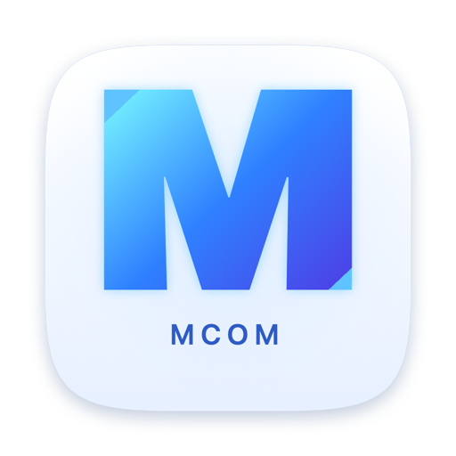
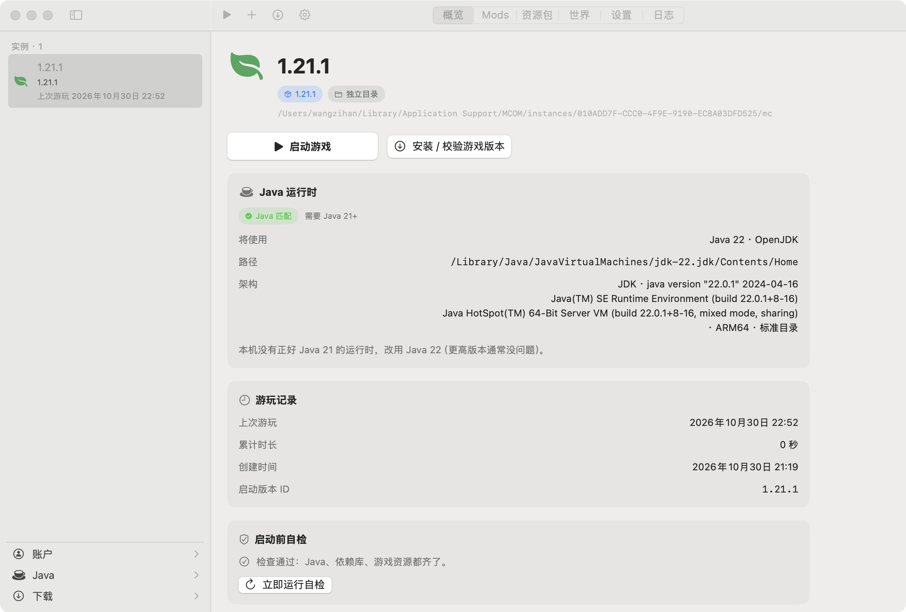
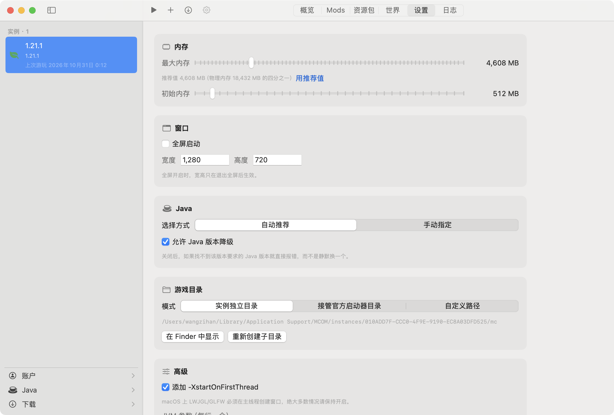
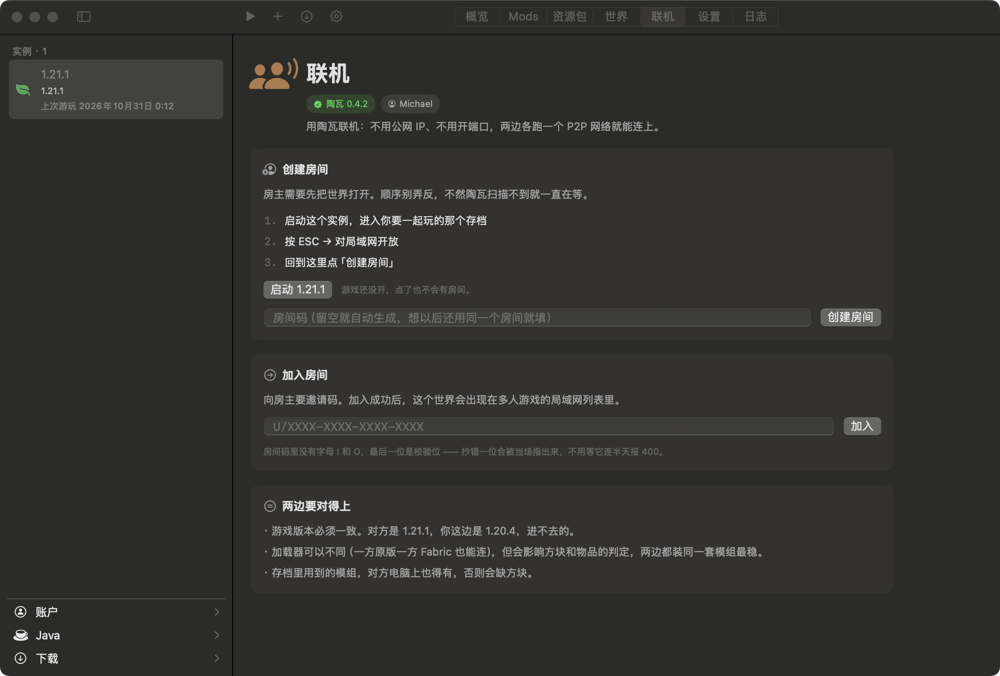

<div align="center">



# Macl

**用 Swift 和 AppKit 从零写的 macOS Minecraft 启动器。13 MB，没有 Electron，也没有网页套壳。**

[下载最新版](https://github.com/apple-PC/macl/releases/latest) · [官网](https://apple-pc.github.io/macl/) · [更新日志](CHANGELOG.md)

</div>



## 这是什么

Macl 是一个第三方 Minecraft 启动器，只做 Mac。它把「装游戏、配 Java、点启动、出问题能查」这四件事做完，不往里面塞别的。

启动器本身 13 MB，压缩包 4 MB。没有安装器，解压拖进「应用程序」，双击就能开。不需要注册账号，离线账户直接玩。

界面用的是系统控件，不是画在窗口上的一层网页 —— 切深色模式、全屏、分屏、改系统字号，它都跟着变。

## 安装

**1. 下载解压**

从 [Releases](https://github.com/apple-PC/macl/releases/latest) 下 `Macl-x.y.zip`，双击解压得到 `Macl.app`。

**2. 拖进「应用程序」**

放哪儿都能跑，但放进 `/Applications` 才能被 Spotlight 找到、被程序坞固定。

**3. 第一次打开：右键 → 打开**

Macl 没有 Apple 公证（个人开发者，一年 99 美元的账号还没买）。直接双击会被 Gatekeeper 拦下，提示「无法验证开发者」。

这不是病毒警告，是「Apple 没见过这个开发者」。Macl 用 ad-hoc 签名并开启了 Hardened Runtime，代码是完整的、没被篡改过。两种办法都能打开：

- Finder 里按住 `Control` 点按 Macl → 选「打开」→ 再确认一次。之后就正常双击了。
- 或者跑一行命令去掉隔离标记：

  ```bash
  xattr -dr com.apple.quarantine /Applications/Macl.app
  ```

**4. 确认有 Java**

Macl 不捆绑运行时，用你系统里已有的那份：

```bash
/usr/libexec/java_home -V
```

列出一串版本号就说明有。如果提示 `Unable to find any JVM`，去 [Adoptium](https://adoptium.net)（免费，不用注册）或 [Oracle](https://www.oracle.com/java/technologies/downloads/) 装一个 JDK 21，装完不用配 `JAVA_HOME`，Macl 自己去 `/Library/Java/JavaVirtualMachines` 底下数。

只玩新版装 JDK 21 就够。想开 1.16 或更早，还得再装个 JDK 8 —— 注意 Oracle 那个包的下载文件名是 `macosx` 不是 `macos`。几个版本同时装着不会打架，Macl 按实例挑。

## 系统要求

| | |
|---|---|
| 系统 | macOS 14 Sonoma 或更高 |
| 芯片 | Apple Silicon 与 Intel 通用（同一个二进制，不是两份） |
| Java | 不捆绑。1.20.5+ 要 Java 21，1.18–1.20.4 要 17，1.16.5 及更早要 8 |
| 磁盘 | Macl 本身 13 MB；每个游戏版本约 300 MB – 1 GB |
| 网络 | 首次装版本要联网，之后可完全离线启动 |

## 能做什么

- **实例管理** —— 每个实例有自己的内存、窗口尺寸、Java 版本、游戏目录和 JVM 参数。同一个人可以同时留着 1.21.1 和 1.8.9，各玩各的。
- **模组加载器** —— 新建实例的第二步就能选原版、Fabric、Forge、NeoForge、Quilt，版本号在同一个弹窗里挑。
- **装好了还能换** —— 原版实例随时补装加载器，已装的随时换一个、或者卸掉退回原版。换的时候先装新的、成功了才清旧的，断网也不会把实例搞成半残；卸载只删实例私有那份 profile，存档和 `mods/` 一个都不碰，删之前会告诉你要删多少 MB、里面有多少个 jar。
- **联机不用碰路由器** —— 借 [Terracotta](https://github.com/burningtnt/Terracotta) 打 P2P 洞，一个人建房间拿到 `U/XXXX-XXXX-XXXX-XXXX`，另一个人粘进去就能进同一个世界。不用公网 IP，不用做端口映射。房间码粘错了当场就提示，不用等对面超时。
- **整合包拖进来就能玩** —— CurseForge（`.zip`）和 Modrinth（`.mrpack`）直接导入，导入前先预览游戏版本、加载器和 mod 数量；CurseForge 的 mod 自动经社区镜像补下。也能反向导出：整个实例打成 Macl 备份 zip，或标准 `.mrpack` 分给别人。
- **导入前先体检** —— 离线扫包内 mod 的元数据，加载器冲突、缺前置、游戏版本不符、只有 Windows 原生库的 jar 都会提前报出来，不用等进游戏崩了再二分排查。
- **网络问题能自己解释** —— 每次下载的成败与耗时记进本机画像，被墙的线路自动沉底；设置页能看到「为什么走镜像」，日志页把报错翻成人话和修复建议。画像只存本机。
- **Java 按版本自动匹配** —— 版本 JSON 要 21 就去全机找 21；找不到才退一步用 22，并且把「本机没有正好 Java 21 的运行时，改用 Java 22」摆在界面上，不闷着头替你换。
- **双源版本清单** —— 官方和国内镜像同时问，谁先回来用哪个。Alpha 时代的老版本也能装。
- **启动前自检** —— Java、依赖库、资源索引，缺哪个、缺多少个，直接写在卡片里，不用启动失败之后再猜。
- **坏了会自己修** —— 版本 JSON 对不上就重下，依赖库缺了就补，缓存读坏了就扔掉。
- **日志留全** —— stdout、stderr、退出码，连实际执行的那条命令行都存着，可以一键复制。崩了不用靠猜。





## 数据放在哪

全程用官方启动器那套目录结构，所以哪天不想用了，官方启动器或 HMCL 直接接手，存档不用搬。

```
~/Library/Application Support/Macl/
├── accounts.json          账户（离线）
├── launcher.json          全局设置
├── instances/
│   └── <实例名>/           每个实例一个目录
├── versions/              版本 JSON 与 jar
├── libraries/             依赖库
├── assets/                资源索引与对象
└── cache/                 下载缓存
```

游戏存档、模组、资源包都在实例目录下的 `saves/`、`mods/`、`resourcepacks/`，和官方 `.minecraft` 里一模一样。

## 常见问题

**打开时提示「无法验证开发者」／「已损坏」**
见上面安装第 3 步。`已损坏` 和 `无法验证` 是同一件事，都是没公证，不是文件真的坏了。

**提示本机没有合适的 Java**
装一个 JDK 21 就够了。想开 1.16 及更早的版本，再补一个 JDK 8。装完不用重启 Macl，回到实例设置里刷新一下就能选到。

**游戏启动后退出了，界面只闪一下**
去实例的「日志」页，里面是完整的 stdout/stderr 和退出码。常见原因是内存给太小，或者模组不兼容。

**支持哪些版本？**
全部正式版，从 Alpha 到现在。快照理论上也能装，但没系统测过。

**会和官方启动器冲突吗？**
不会。两者用不同的数据目录，互不干扰；Macl 的目录结构本身是兼容的，需要时可以把实例目录指到官方 `.minecraft` 上。

**能登微软正版账号吗？**
暂时只能离线。令牌的 Keychain 保管已经实现，但微软 OAuth 登录流程和界面还没做。

**怎么和朋友联机？**
进实例详情的「联机」页签。一个人点「创建房间」，拿到一串 `U/` 开头的房间码发给朋友；朋友在他的 Macl 里粘进去点「加入」，剩下的它自己弄。第一次用会下载陶瓦（12–14 MB），macOS 会弹一次管理员密码——那是给它本地网络权限用的，只弹这一次。
两边要选同一个游戏版本、同一套模组，否则进了也连不上。

**卸载加载器会删掉我的存档吗？**
不会。只删实例私有 `versions/` 下那份加载器 profile，`saves`、`mods`、`resourcepacks`、`config` 一个都不动。
但卸掉加载器之后 `mods/` 里那些 mod 也不会被加载了，所以确认框会把里面有多少个 jar 摆在最前面提醒你。

## 已知限制

- **没有公证**，首次打开必须右键或去掉隔离标记，每次都写在下载说明里。
- **只有离线账户**，暂时不能进需要正版验证的服务器。
- **联机还没做过真正的双机对连**：房间码校验、状态机、下载与提权流程和界面都验过了，
  但「两台 Mac 真的连上、进同一个世界」这条路径还没跑过，第一次用请留意。
- **整合包导入／导出**逻辑写好了，还没接界面入口，现在只能手动把 `mods/` 拖进去。

## 声明

Macl 是独立开发的第三方启动器，与 Mojang Studios、Microsoft 无任何关联，也不代表它们。

Minecraft 是 Mojang Studios 的商标。使用本软件需要你自行拥有合法的 Minecraft 账户。本项目不分发任何游戏本体、资源或模组文件。

## 许可

[MIT](LICENSE)。随便用、随便改、随便分发，保留版权声明即可。
## 支持 Macl

Macl 免费、无广告，也不打算收费。唯一需要花钱的地方是 Apple 开发者账号（$99/年）—— 有了它就能给安装包做公证，第一次打开不用再右键「打开」。

如果你想帮忙把这件事推过去，可以在 [爱发电](https://afdian.com/a/apple-pc) 支持。Star 仓库、提 issue、帮着传播一样有用；所有功能都不会因为是否支持而有区别。
